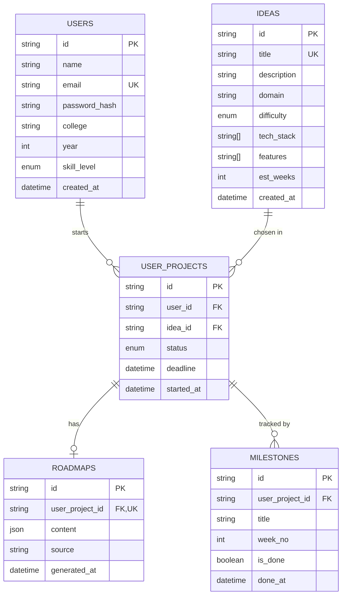

# Database design

PostgreSQL, managed with Prisma (`backend/prisma/schema.prisma`).

## Design decisions

- **`user_projects` joins users and ideas** with a unique `(user_id, idea_id)` pair, so a student cannot save the same idea twice.
- **Roadmap stored as JSON.** The plan's shape (summary, modules, weeks) can evolve without migrations, and the AI returns JSON directly.
- **Milestones are real rows**, created from the roadmap's weekly tasks. This makes progress queries (`count where is_done`) simple and fast.
- **Cascade deletes.** Deleting a user or project removes its roadmap and milestones.
- **Idea titles are unique**, so the seed script can be re-run safely: it inserts only ideas with new titles and never deletes existing ones (which would cascade-delete students' projects).
- **Indexes** on `ideas.domain`, `ideas.difficulty` and foreign keys keep filtering and dashboard queries fast.
- **Enums** (`SkillLevel`, `ProjectStatus`) keep values consistent at the database level.
